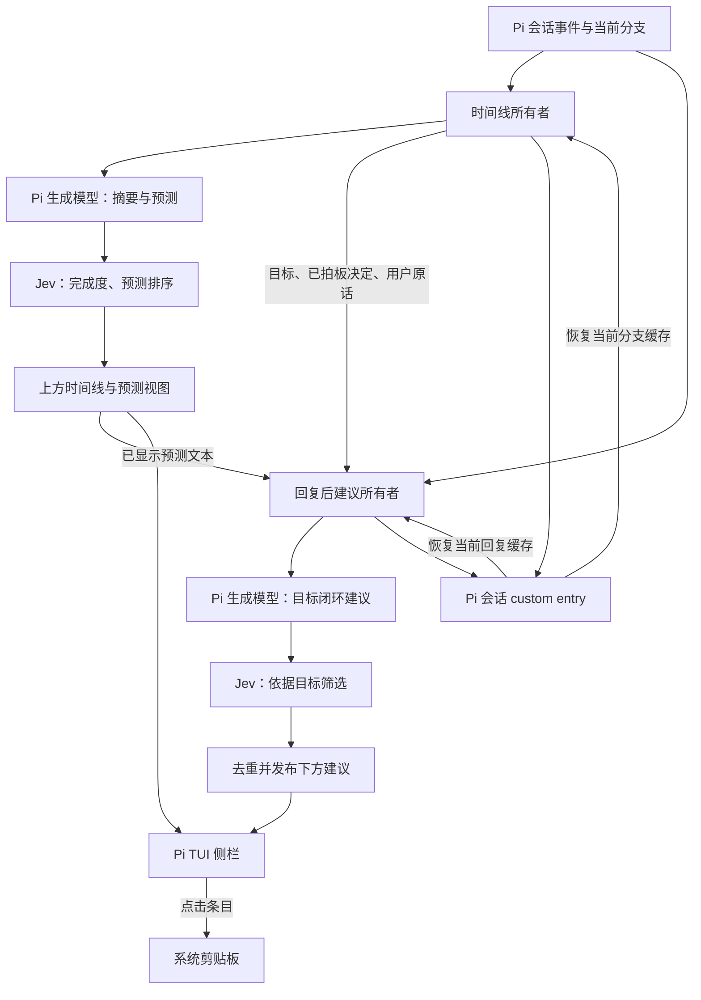

# pi-session-sidebar

A session sidebar for the [Pi coding agent](https://github.com/earendil-works/pi): timelines, next-message predictions, and post-reply advice in your terminal. Built with TypeScript and Pi's extension/TUI APIs. 当前界面和生成提示词以简体中文为主。

**看清这段对话做了什么、下一句可能说什么，以及离最初的目标还差什么。**

```text
┌────────────────── Pi 主会话 ──────────────────┬──────── 会话侧栏 ────────┐
│                                              │ 会话目标                │
│ 助手回复、工具输出、你的输入                   │ 阶段 → 意图 → 结果      │
│                                              │ 已拍板的决定 / 当前状态 │
│                                              │ ╰┄ 预测下一步           │
│                                              │   ① 94% 试试跨行复制    │
│                                              │ ╰┄ 预测下一步执行方向   │
│                                              │   ◇ 完善交互            │
│                                              ├────────────────────────┤
│ 输入框：保留你的草稿                           │ 回复后建议 · 点选复制   │
│                                              │ 确认最终验收条件        │
│                                              │ └ 依据：目标尚未验收    │
└──────────────────────────────────────────────┴────────────────────────┘
```

这是布局示意，百分比和文案为演示内容。

## 功能

| 功能 | 行为 |
| --- | --- |
| 会话时间线 | 按阶段展示用户意图、助手结果、已确认的决定和当前状态，返回老会话时容易接上进度。 |
| 下一步预测 | 摘要模型生成候选，Jev 按“用户下一句可能说什么”评分，显示前三条及更大的执行方向。 |
| 回复后建议 | 独立检查“离用户最初的目标还差什么”，每条附依据；与上方预测重复时让位。 |
| 完成度与压缩检查 | Jev 评估每轮完成程度，并检查上下文压缩后的目标与阶段是否仍一致。分数是模型判断。 |
| 完整复制 | 点击预测、方向或回复后建议复制完整提示词，显示成功/失败反馈；不会改动已有输入草稿。 |
| 可调整布局 | 拖动分界线或用快捷键调宽；文本按完整缓存重新换行，上下区域分别滚动。建议区约占可用正文高度的三分之一。 |
| 跨栏选区隔离 | 普通鼠标拖选从哪栏开始，就限制在该栏；输入框跨行复制不会夹带侧栏。 |
| 会话缓存 | 摘要、预测、分数和回复后建议存为 Pi 会话自定义记录；恢复同一分支的有效缓存时直接显示。 |
| 旧会话回填 | 缺失摘要可批量回填，支持重跑、失败重试、模块显示开关和窄屏回退。 |

点击只复制。`Alt+1/2/3` 与显式 `fill` 命令只填入空输入框，不自动发送。这个独立包不包含发送前技能推荐浮层。

## 安装

需要 **Node.js 22.19+** 和 **`@earendil-works/pi-coding-agent` 1.0.2+**。目前对 Pi / pi-tui **1.0.2** 做过类型、真实加载器及真实渲染器验证；更高版本需要重新确认内部 TUI 适配。

```bash
pi install git:github.com/KonglingDaDa/pi-session-sidebar
```

新开 Pi 或执行 `/reload`。建议使用全屏终端模式：

```bash
pi --tui-mode fullscreen
```

也可以从源码试用：

```bash
git clone https://github.com/KonglingDaDa/pi-session-sidebar.git
cd pi-session-sidebar
npm ci
pi -e ./src/index.ts --tui-mode fullscreen
```

避免同时加载原来的 `session-timeline` / `task-assistant` 本机版本和这个包，它们注册相同的命令与事件。使用其他同样接管全屏布局的扩展时，也需要检查是否兼容。

## 模型配置

侧栏使用两类模型：

- **生成模型**通过 Pi 的 `modelRegistry` 调用，生成每轮摘要、下一步候选和回复后建议。默认是 `google/gemini-2.5-flash`，凭据由 Pi 管理；也可选自己已有的、能输出所需 JSON 的模型。
- **Jev（TypeSafe System One）**通过 HTTP 调用，用于评分、筛选和一致性检查。默认地址是 `https://api.typesafe.ai/v1/systemone`，需要自己的 TypeSafe key。

生成模型必须出现在 Pi 的模型列表中，可以先检查：

```bash
pi --list-models
```

在启动 Pi 的 shell 中设置自己的凭据，例如：

```bash
export GEMINI_API_KEY="YOUR_GOOGLE_API_KEY"
export TYPESAFE_API_KEY="YOUR_TYPESAFE_API_KEY"
pi --tui-mode fullscreen
```

不要把实际 key 放进仓库。这个包不会自动读取 `.env` 文件；请用 shell、进程管理器或 Pi 自身的凭据管理。

### 选择生成模型

可用环境变量设置默认模型：

```bash
export PI_SIDEBAR_SUMMARY_PROVIDER="google"
export PI_SIDEBAR_SUMMARY_MODEL="gemini-2.5-flash"
```

侧栏设置保存于 `~/.pi/agent/session-timeline.json`；如果设置了 `PI_CODING_AGENT_DIR`，则使用该目录。已有文件中的 `summary` 会覆盖环境变量给出的默认值。以下是可合并的配置示例：

```json
{
  "version": 2,
  "enabled": true,
  "width": 42,
  "summary": {
    "provider": "google",
    "model": "gemini-2.5-flash",
    "thinking": "high",
    "timeoutMs": 90000
  },
  "jev": { "enabled": true, "timeoutMs": 12000 },
  "backfill": { "auto": true, "maxTurns": 60, "batchSize": 8 }
}
```

请合并进已有文件以保留模块开关。回复后建议默认跟随这个 `summary` 模型，也可单独覆盖：

```bash
export PI_SIDEBAR_ADVICE_PROVIDER="google"
export PI_SIDEBAR_ADVICE_MODEL="gemini-2.5-flash"
```

修改生成模型后执行 `/reload`。

### Jev 地址与 key

key 优先从 `SYSTEMONE_API_KEY`、`TYPESAFE_API_KEY` 读取；其次读取 `~/.config/typesafe/systemone.env`。端点优先读取 `SYSTEMONE_ENDPOINT` 或 `TYPESAFE_BASE_URL`，再读取上述配置文件，最后使用官方地址。`TYPESAFE_BASE_URL` 填 origin，不包含 `/v1`；客户端会追加 `/v1/systemone`。

可使用本机回环网关：

```bash
export SYSTEMONE_ENDPOINT="http://127.0.0.1:18650/v1/systemone"
```

地址校验只接受 TypeSafe 官方 HTTPS 或本机回环地址。此仓库不提供网关服务。

`jev.enabled: false` 关闭时间线的 Jev 打分与压缩检查，上方预测仍可显示生成模型的原始顺序；下方建议有自己独立的 Jev 筛选，若不使用它请执行 `/task-assistant off`。

## 操作

| 操作 | 效果 |
| --- | --- |
| `Alt+S` 或 `/timeline` | 切换时间线侧栏。 |
| `Alt+,` / `Alt+.` | 调窄 / 调宽。 |
| `/timeline width 50` | 设置宽度，范围 24–80 列。 |
| `Alt+1` / `Alt+2` / `Alt+3` | 把对应预测填入空输入框；已有草稿时保留草稿。 |
| 点击预测 / 方向 / 建议 | 复制完整提示词，保持输入框不变。 |
| 鼠标滚轮 | 滚动所在区域。 |
| `/timeline modules` | 查看可切换模块。 |
| `/timeline show tools` / `/timeline hide tools` | 显示 / 隐藏指定模块。 |
| `/timeline status` | 查看模型、回填、打分与侧栏状态。 |
| `/timeline retry` | 重试失败的摘要或打分。 |
| `/timeline backfill` | 确认后补齐当前分支的缺失时间线。 |
| `/timeline redo` | 确认后重跑当前分支时间线。 |
| `/timeline check` | 检查最近一次上下文压缩。 |
| `/task-assistant on` / `off` | 开关回复后建议，仅对当前 Pi 进程有效。 |
| `/task-assistant status` | 查看建议状态与筛选诊断。 |
| `/task-assistant retry` | 对当前回复重新生成建议，不发送主模型消息。 |
| `/task-assistant fill 1` | 显式把第 1 条建议填入空输入框，不发送。 |

非全屏或终端太窄时侧栏无法分栏，上方预测会回退到输入区下方；回复后建议仍可通过命令查看状态和填入。

## 框架结构

插件没有独立网页或服务端。Pi 提供会话事件、模型注册表、剪贴板和 TUI，插件负责背景分析与侧栏渲染。

```text
src/
├── index.ts                     # 唯一安装入口，组装两个事件所有者
├── timeline/
│   ├── index.ts                 # 时间线生命周期、队列、回填、命令与持久化
│   ├── core.ts                  # 纯逻辑：拆轮、统计、解析、脱敏、阶段视图
│   ├── contracts.ts             # 时间线记录、分数、配置和输出类型
│   ├── summarize.ts             # 摘要 / 候选提示词与 Pi 模型调用
│   ├── jev.ts                   # 完成度、预测排序、压缩一致性问卷
│   ├── assistant-owner.ts       # 目标锚与覆盖文本；消费下方建议事件
│   ├── sidebar.ts               # HStack 分栏、文本布局、拖宽、滚动、点击复制
│   ├── sidebar-layout.ts        # 区域高度和滚动边界的纯函数
│   └── column-selection.ts      # TUI 跨栏选区适配，隐藏时恢复原方法
├── advice/
│   ├── index.ts                 # 回复后建议生命周期与 /task-assistant
│   ├── events.ts                # 版本化 EventBus 交接协议
│   ├── postreply.ts             # 上下文、生成、依据校验、去重与筛选
│   ├── postreply-queue.ts       # 异步任务、取消、过期检查与发布
│   ├── postreply-cache.ts       # 会话自定义记录缓存的恢复 / 构造
│   ├── gemini.ts                # 可配置的 Pi 生成模型客户端（历史文件名）
│   ├── session-context.ts       # 可见对话的有界提取
│   └── redact.ts / limits.ts    # 脱敏与字数、耗时、分数边界
└── shared/
    ├── models.ts                # 模型默认值与环境 / JSON 配置
    ├── jev-client.ts            # Jev 地址、key、HTTP、超时与错误
    ├── questions.ts             # Jev 原生 question 类型
    └── context.ts / redaction.ts
```

### 数据流与状态归属



时间线所有者写摘要与分数；建议所有者写自己的完成缓存。两者通过 `pi.events` 的 v1 协议交换 `hello`、`advice-context`、`advice-covered`、`update`、`clear`，事件按会话与回复绑定。上方正在显示的预测变化时，下方再次检查重复；迟到结果不能覆盖新轮。

生成模型写候选，代码负责 schema、长度、有效依据、去重和过期校验，Jev 提供评分；渲染层只负责显示与交互。时间线的摘要队列一次一条，时间线 Jev 队列最多三条并发；回复后建议有独立任务与取消信号。

### 缓存

- 时间线：会话 custom type `session-timeline` 与 `session-timeline-compaction`。
- 回复后建议：`pi-local:task-assistant:postreply-cache` v1。保留历史命名以兼容已有记录。
- 建议缓存校验会话 ID、当前分支、回复 ID 与本轮最后消息；不会跨分支显示错误结果。
- 已完成的建议、依据、空结果和失败状态会持久化，`pending` 不视为完成缓存。
- 有有效最新缓存时重开 / `/reload` 直接恢复；新消息、分支切换或压缩会取消旧任务，显式 retry 会重算。
- 没有建议缓存时显示“暂无缓存”，不会仅因重新打开会话自动生成下方建议。时间线缺失记录仍可能触发已配置的自动回填。

自定义记录不作为普通聊天消息进入主模型上下文。缓存随 Pi 会话文件保存，不依赖另一个数据库。

## 数据与费用

后台分析会把经过长度限制和凭据形状脱敏的用户消息、助手可见回复、目标及工具动作摘要发送给所配置的生成模型与 Jev；不发送完整工具输出、图片或隐藏推理。脱敏是尽力处理，并不能识别所有敏感信息。原始 Pi 会话仍由 Pi 自身管理。

生成与评分会产生你所配置服务的调用费用。自动回填默认最多最近 60 轮，每包最多 8 轮；可将 `backfill.auto` 设为 `false`。手动大范围回填 / 重跑会先确认，界面内的费用值仅为历史估算，不是服务报价。

## 兼容性与故障处理

- 全屏分栏和选区隔离适配 Pi 的内部渲染方法，版本升级后可能需要更新；适配前检查必要方法，失败时显示状态或回退，不修改已安装的 Pi 源码。
- Shift 强制终端原生选区绕过 Pi，不受跨栏隔离控制。
- 剪贴板依赖 Pi 自身支持的终端 / 系统路径，远程终端可能受限制，失败会显示反馈。
- 模型输出不是保证正确的事实；完成度和下一句概率只供参考，不代表自动授权执行。
- “找不到模型”：检查 `pi --list-models`、provider/model 配置及 Pi 凭据。
- “缺少 intent”：生成模型输出不符合摘要字段要求；原会话保留，用 `/timeline retry` 重试。
- Jev 失败：上方保留未评分候选；下方显示未判定，不将失败当成无建议。
- 旧版本缓存若曾被截断，拖宽不能还原已丢失内容；手动 retry 或新一轮会生成完整结果。

## 开发与验证

```bash
npm ci
npm run check
```

`check` 包含严格 TypeScript 检查、离线测试和安装包内容检查。测试覆盖轮次与分支状态、JSON 解析、目标锚、迟到事件、建议依据、缓存持久化、真实 Pi 加载器、真实 TUI 渲染器、选区隔离、拖宽重排及完整复制；不会调用真实模型。GitHub Actions 在 Node 22 上运行同一套检查。

运行时依赖由 Pi 宿主提供；开发依赖固定 Pi / pi-tui 1.0.2 以便验证。`package.json` 的 `pi.extensions` 只暴露 `src/index.ts`，内部模块不会被逐个注册。

发布版从本机 `pi-local` 的时间线与回复后建议提取，已移除对记忆重排、task-pilot 和个人网关的源码依赖。原有会话协议命名保留，便于迁移。

## 许可证

[MIT](LICENSE) © 2026 KonglingDaDa。
